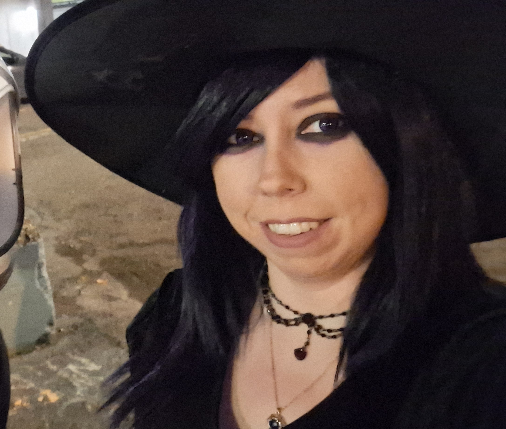
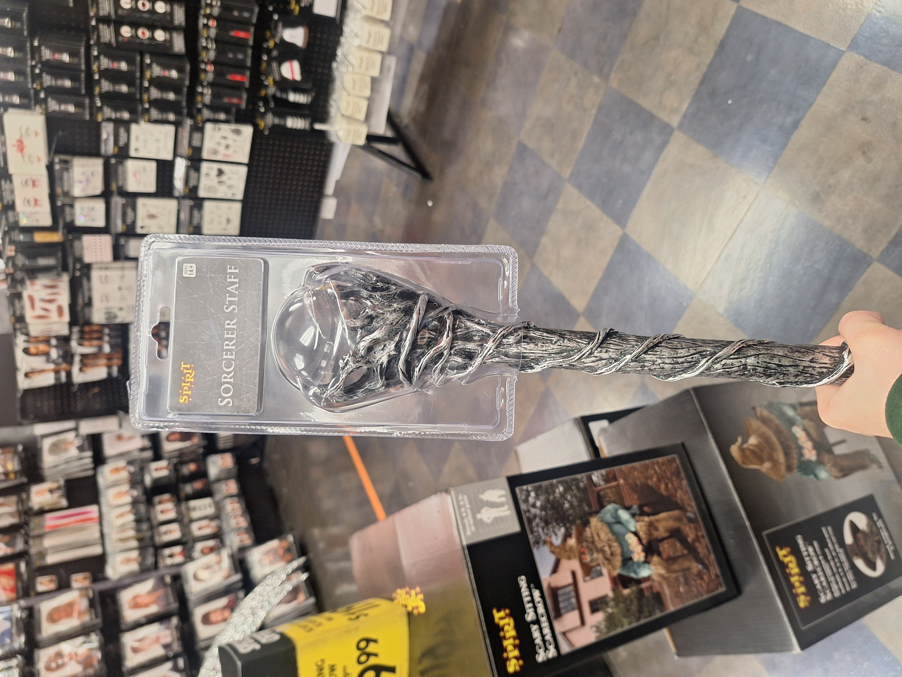
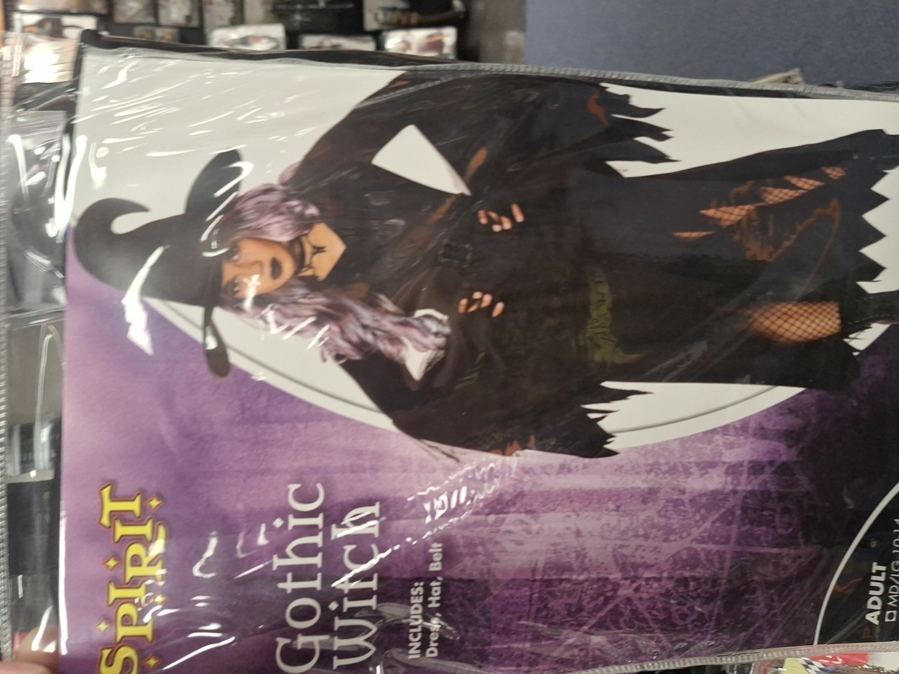
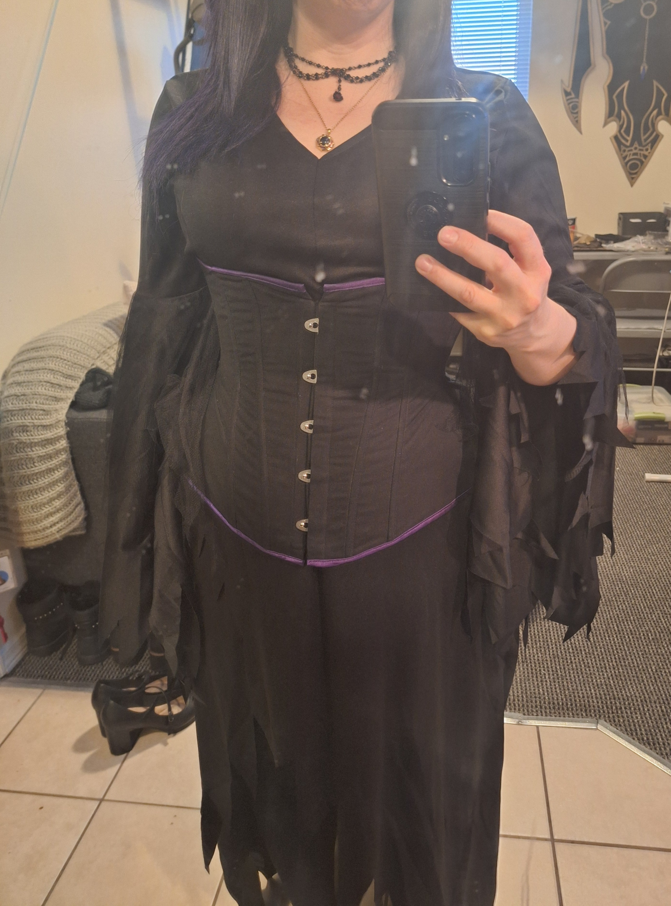
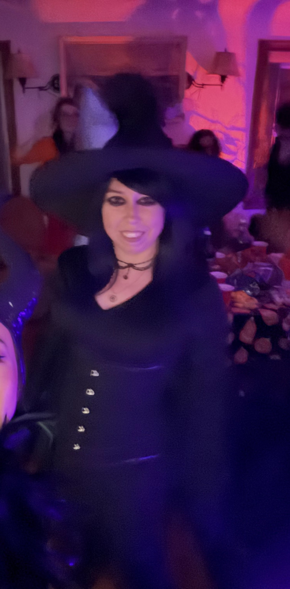
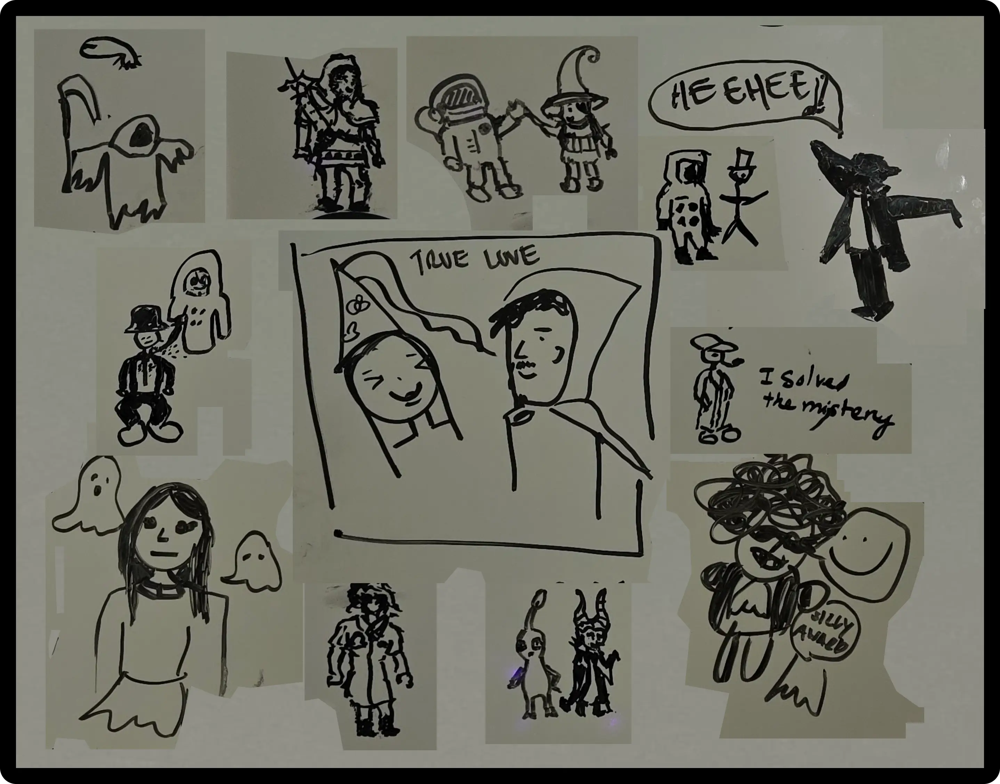

Halloween feels a little different now that I'm a cosplayer.

I've been thinking about this since seeing everyone dressed up for Halloween. There was a time when Halloween was one of the few opportunities to put on a costume and go out as someone else. Now I do that several times a year, often after spending months making the costume myself.

I made costumes when I was younger, too. I remember dressing as Hermione in eighth grade with help from my mom, making costumes in high school, going to Renaissance Faires, and trick-or-treating for the last time when I was 17. I've always enjoyed dressing up.

But cosplay has changed my relationship with costumes. Getting dressed for a convention can feel more like preparing for a performance. There's the costume itself, the makeup, the wig, the accessories, and the inevitable last-minute repairs. Sometimes there are photoshoots, meetups, or even competitions to prepare for.

And after BlizzCon, I haven't exactly been motivated to make anything.

I have plenty of things I *could* be working on. Xal'atath still needs repairs, and I have future costumes planned. But the desire to sit down and build something just hasn't been there lately. It's a strange feeling when making costumes is such a big part of what I do.

So when a friend invited me to a Halloween party, I decided to do something a little different.

## A costume from Spirit Halloween?

<figure>
  

    
    
  

  <figcaption>
    The staff that started it all, and the costume I bought to go with it.
  </figcaption>
</figure>

I actually bought a Halloween costume. For the first time in my adult life.

A trip to Spirit Halloween started without a particular character in mind. There were a few possibilities, but what ultimately caught my attention was a staff with an orb on top.

I wanted the staff. The costume was almost secondary.

A generic witch costume ended up coming home with me, too. Of course, I wasn't going to wear it exactly as it came out of the package. Apparently, even when I buy a costume, I still can't leave it alone.

I took the wig, contacts, and purple makeup I use for Xal'atath and combined them with the dress. I added jewelry and wore one of my corsets over it. A witch hat completed the outfit.

And that was it. I was a witch.

Not a witch from a movie, game, or television show. Just a witch.

I joked with my Alleria friend that I was Xal'atath cosplaying as a human.

Honestly, take off the hat and I look like I'm going to the Mercury. I've worn the wig, makeup, and contacts there before, and nobody bats an eye. The goth aesthetic already fits me, so in some ways this was just me dressing up as myself.

## Getting ready was actually fun

<figure>
     
     <figcaption>Originally made to go under my Xal'atath costume. Turns out it works pretty well over a witch dress, too.</figcaption>
</figure>

One of the things I enjoyed most was simply getting dressed.

I took my time doing my makeup, putting on the wig, and getting everything together. There wasn't a costume piece I needed to finish or a construction problem I was desperately trying to solve before leaving.

It reminded me a little of getting ready for a homecoming dance. You spend time doing your hair and makeup, choosing what to wear, and getting excited about going somewhere.

Except this time I was doing it for myself, at my own pace, and it was relaxing.

That's a very different experience from getting ready for a cosplay competition.

I think that's something I've been missing lately. I still love wearing costumes. In fact, wearing them is probably my favorite part of cosplay. But making them, especially after putting so much work into Xal'atath for BlizzCon, hasn't been nearly as appealing.

This was a chance to enjoy the part I love without having to do all the work that usually comes first.

## The Halloween party

<figure>
     
     <figcaption>Just a witch. Nobody in particular.</figcaption>
</figure>

The party was at an old house, with about twenty people packed inside. There was food, music, dancing, and plenty of conversation.

The costumes were all over the place, which is exactly what I'd expect from a Halloween party.

We had fantasy characters like Link and someone from Lord of the Rings, along with a Pikmin, what I think was an inflatable Among Us character, vampires, classic horror costumes, Beethoven, a Top Gun pilot, and an astronaut.

The astronaut was my boyfriend.

He had picked out a white helmet with a mirrored visor, which looked pretty cool except that the visor kept falling down. Eventually someone found a binder clip to hold it up.

I tried helping him push the visor out of the way, but he wasn't particularly interested in my assistance. Eating was also a challenge, and I jokingly offered to help feed him.

He declined.

Usually he's the one helping me when I'm in costume, so it was funny seeing the situation reversed. Apparently he prefers to manage his own costume problems.

Meanwhile, I received several compliments on my hair dye.

I got to tell people it was a wig.

The staff that inspired my entire outfit ended up spending much of the party in a corner next to a scythe someone else had brought. I guess the fantasy weapons needed somewhere to hang out.

I also met someone who had dressed as a princess simply because she liked the hat and wanted to make an outfit around it.

That sounded awfully familiar.

She liked a hat. I liked a staff. Neither of us needed a particular character to justify dressing up.

At some point, someone made a drawing featuring everyone at the party. I found it afterward in the shared photo drive, and it's such a fun little souvenir. There's my witch, my boyfriend's astronaut, and a whole collection of other costumes, including a couple drawn together under the words "True Love."

I also found a couple of pictures of myself. One was pretty good. The other... well, it was definitely a party photo.

<figure>
     
     <figcaption>The Halloween party cast, immortalized in whiteboard doodles.</figcaption>
</figure>

## Somehow I ended up talking about cosplay anyway

I knew the host through the makerspace and our cosplay meetups, so naturally cosplay came up in conversation.

He's actually one of the people I've asked to participate in a panel I'm organizing for Emerald City Comic Con. He started with a background in 3D printing and decided to make a cosplay for PAX last year, despite not knowing how to sew.

He attended meetups, asked questions, got advice, and learned along the way. Now he knows how to sew.

I met his girlfriend for the first time at the party, and she excitedly mentioned that he'd told her he was going to be on a panel at ECCC.

I had to laugh.

We haven't even been accepted yet!

But I appreciate the enthusiasm.

I also had an interesting conversation with another guest who was curious about cosplay but had never tried it.

Since I've been working on the panel, I asked him what questions he had about cosplay. I wanted to hear the perspective of someone outside the hobby.

He brought up perfectionism. How do you deal with wanting everything to be perfect?

I told him about a friend who cosplays Lady Liadrin. She had been concerned that the blades on her pauldrons were too big. I didn't think they were too big. World of Warcraft characters have stupidly oversized pauldrons anyway. It takes one to know one.

Then I looked at the character reference.

Yes, they were bigger than the reference.

But so what?

Most people wouldn't notice. The people who might notice are probably other cosplayers familiar with the character, and even then, they might be more interested in how she constructed everything than whether the proportions were exact.

That's certainly been my experience.

At BlizzCon, there were three of us dressed as Xal'atath backstage. We weren't standing around criticizing each other's costumes. We were comparing how we'd made things and getting ideas from each other.

My favorite discovery?

Clear sandals.

I wore black sandals with my Xal'atath costume. One of the others had clear sandals, which made so much more sense for a character who's supposed to be barefoot.

After all the complicated things I've made for that costume, sometimes the best idea is something ridiculously simple.

The guest also asked about foam. What kind of foam do cosplayers use? Where do you get it? What do you do with it?

These are basic questions to someone who's been making costumes for years, but they're also exactly the sorts of things that can be confusing when you don't know where to start.

It was a good reminder that there are a lot of things experienced cosplayers take for granted. I'm hoping to bring some of that perspective into the ECCC panel.

## Meeting people

One of my favorite things about going out is meeting new people.

I exchanged Discord information with a couple of people from the party, including the guest who'd been asking about cosplay.

I also talked with someone about going to the Mercury.

I tend to bring it up when people ask what I do for fun. A surprising number of people around here have heard of it or thought about going, but you generally need to be invited.

"It's a cult," she said, but in a good way.

Which is especially funny considering my Discord status is "Definitely Not a Cultist."

I should probably message those people before I forget!

There were plenty of conversations throughout the night, and I genuinely had a great time.

In fact, I wanted to stay longer.

Unfortunately, we were taking public transportation, and I didn't want to miss the last bus or train or get home ridiculously late. My boyfriend came back with me to make sure I got home, even though he lives in the opposite direction.

I was grateful for that, and grateful we got to go to the party in the first place.

## Nobody in particular

I've spent a lot of time thinking about why Halloween feels different to me now.

When you spend months creating a costume for a specific character, getting dressed up takes on a different meaning. There are references to follow, pieces to construct, details to get right, and sometimes expectations you put on yourself about the finished result.

That's not necessarily a bad thing. I love cosplay, and I love the process of figuring out how to bring a character into the real world.

But it can also be exhausting.

This Halloween, I didn't have to worry about whether my costume was accurate. I didn't need to finish anything, fix a broken pauldron, or prepare for judging.

I just got to put on an outfit I liked, do my makeup, and go have fun.

And I did.

I enjoyed getting ready. I enjoyed wearing the costume. I enjoyed talking to people, seeing what everyone else came up with, and spending the evening with friends.

I'm still not particularly motivated to start building my next costume. That hasn't magically changed.

But I don't think I've lost my enjoyment of dressing up. If anything, this was a nice reminder of why I enjoy it in the first place.

Sometimes I want to spend months making a ridiculously complicated costume with electronics, armor, and oversized pauldrons.

And sometimes I just want to buy a cool staff, put on a witch hat, and go to a Halloween party.

When people asked who I was supposed to be, I had a very simple answer.

Nobody in particular.