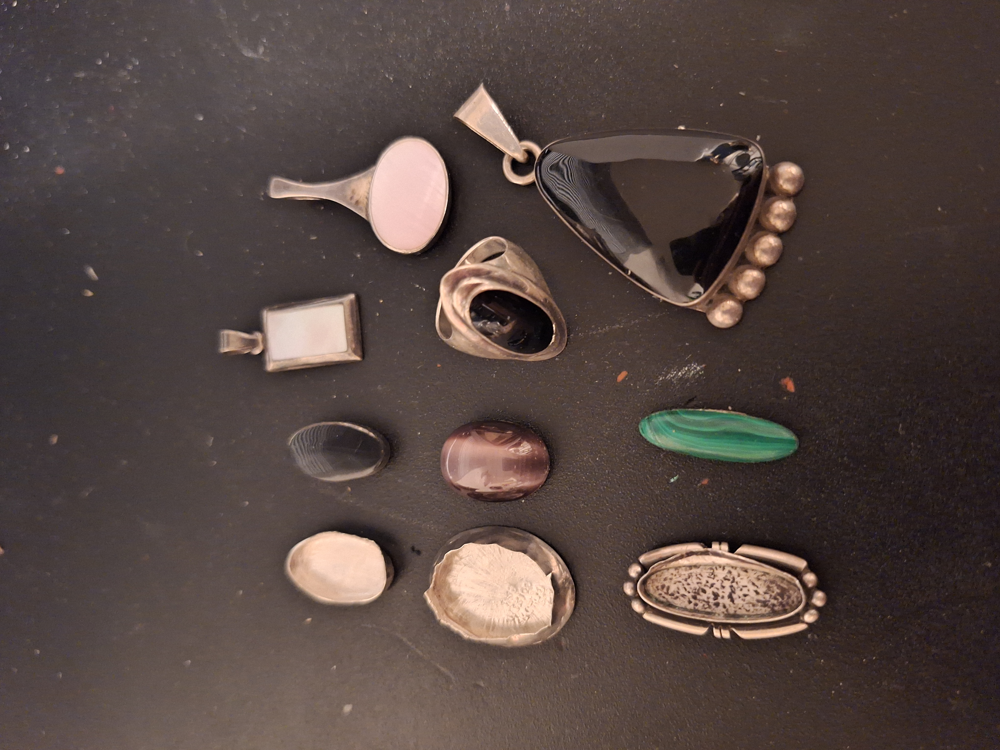
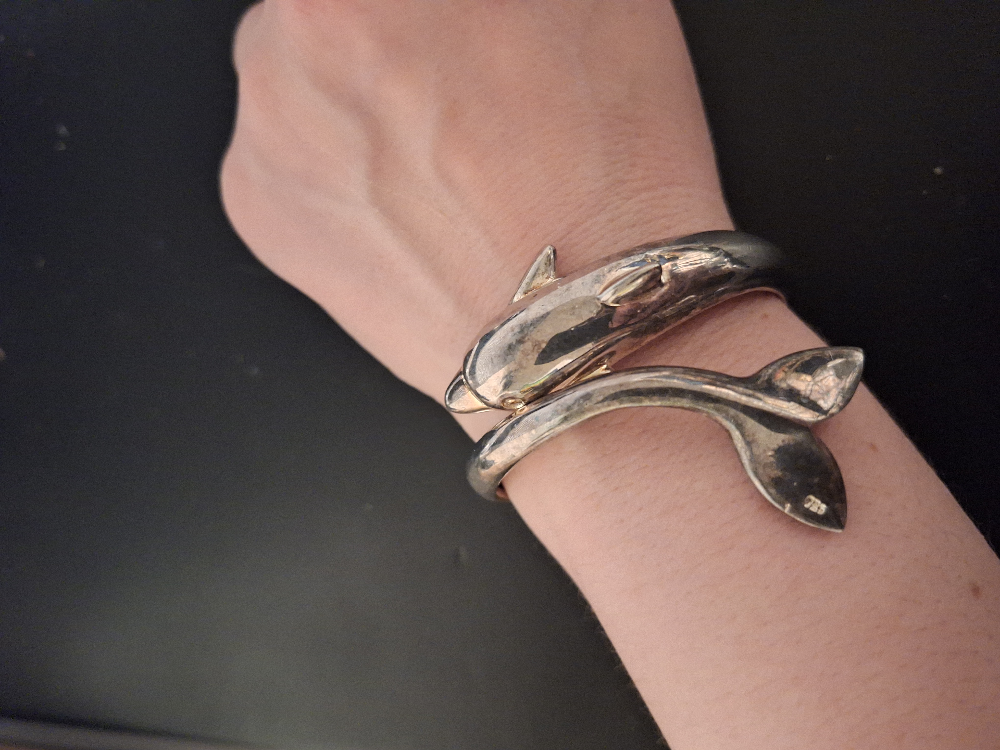
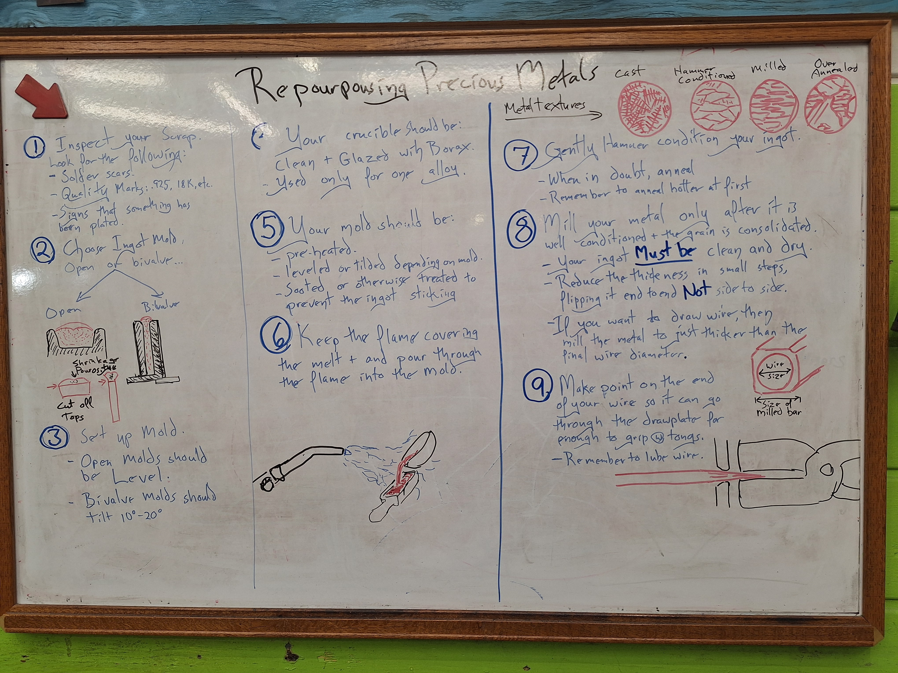
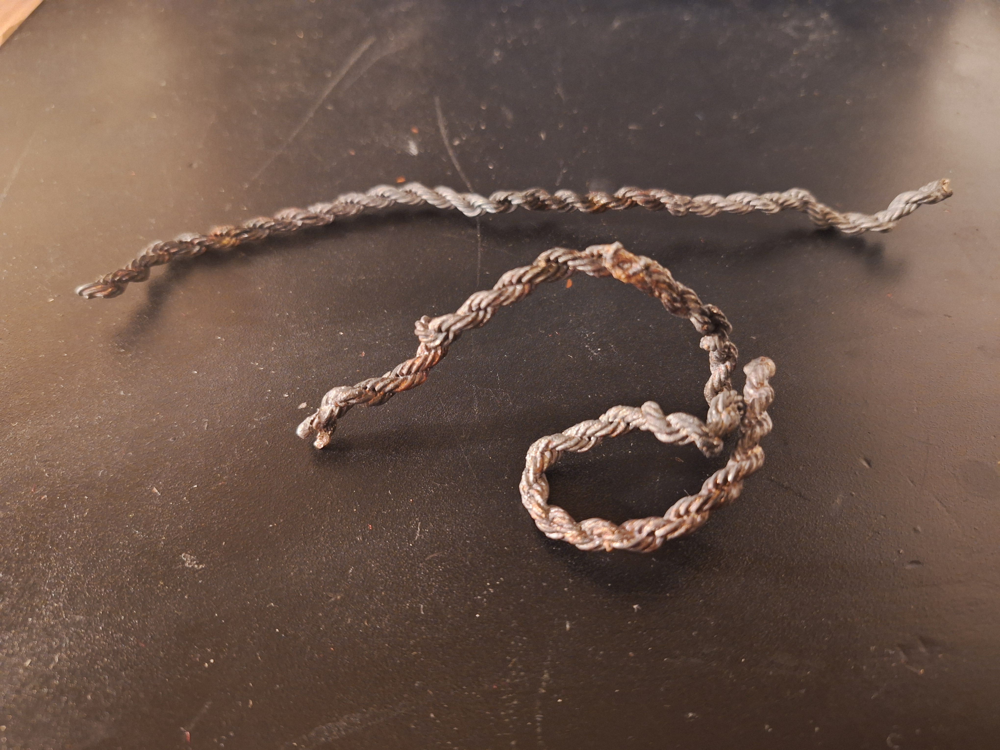
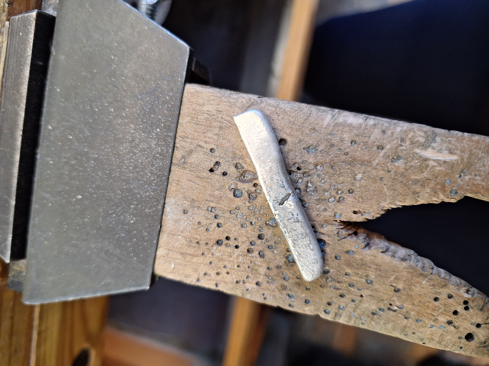
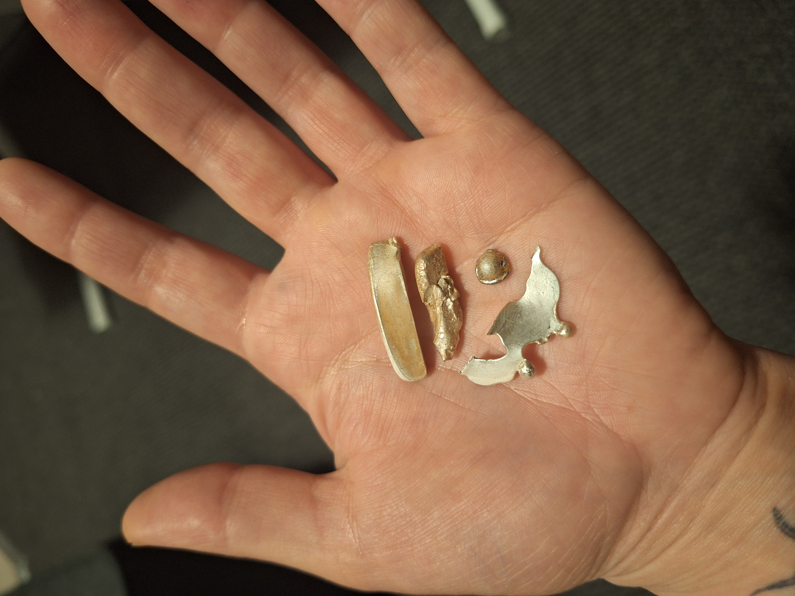
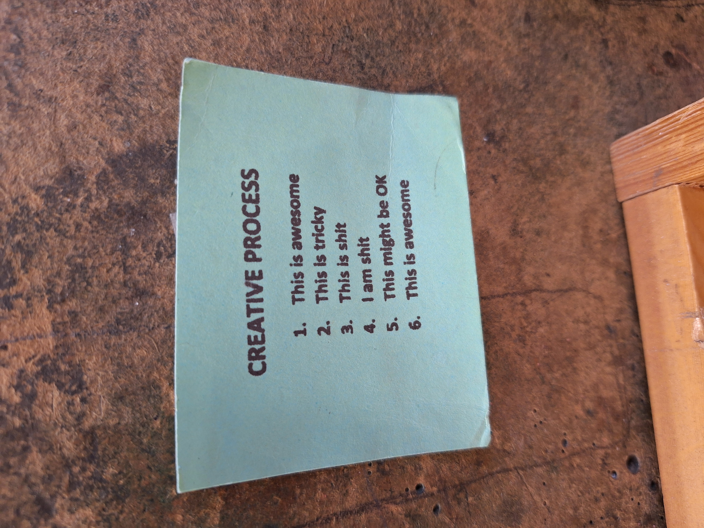
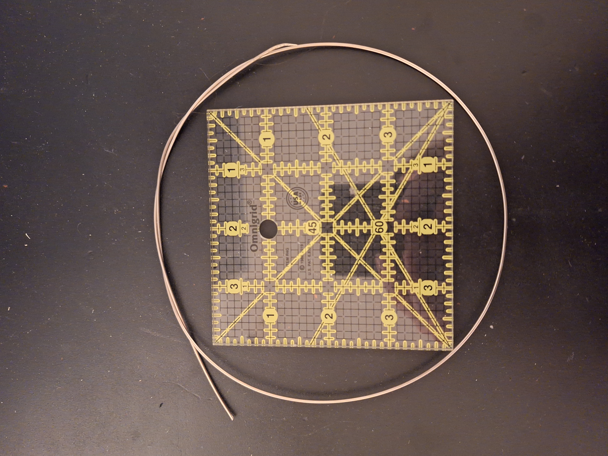

A little while ago, I visited <a href = "https://danacadesign.com/" target="_blank">Danaca Design Studio</a> in Seattle to check out their jewelry facilities. I've recently taken on the role of developing the jewelry program at my makerspace, so I wanted to see how an established studio was organized, what equipment they had, and what kinds of classes they offered.

While looking through their class schedule, I came across one on repurposing precious metals. The idea was to take old jewelry or scrap metal, melt it down, and turn it into usable stock for making new jewelry.

That sounded useful.

I have a ridiculous amount of my grandmother's old jewelry sitting in storage. Much of it is costume jewelry, including plenty of gaudy pins and things I would never wear. I don't particularly want to sell it, but I also don't know what to do with all of it. Maybe I could turn some of it into something useful?

Signing up for the class was a little impulsive. The class itself was $225, but after the materials fee and tax, the total came to $276. Not exactly an inexpensive impulse purchase, but I figured I'd learn a useful skill.

I have previous jewelry-making experience from classes I took at Cal Poly Humboldt, although I graduated in 2023 and haven't worked with a torch since then. This was a class that required prior experience, and everyone else seemed to be actively making jewelry. While I felt like the least experienced person in the room, I didn't feel like I didn't belong.

I was excited to try something new. Little did I know just how much of my silver would disappear over the course of the afternoon.

## The great silver disappearing act

<figure>
  

    
    
  

  <figcaption>
    Some of the jewelry that didn't make the cut. The dolphin bangle was even stamped as silver!
  </figcaption>
</figure>

I arrived with a large bag of my grandmother's old jewelry and started sorting through it. The first step was identifying what could actually be melted down. We learned to look for quality marks, signs of plating, solder joints, and other components that weren't suitable for reclaiming.

I was comfortable with this part. I knew what tools I needed to take jewelry apart and was able to find them around the studio. Unfortunately, that didn't mean everything I brought was usable.

There was a huge dolphin bangle with a spring mechanism that I thought would provide a decent amount of metal. It was even stamped as silver.

Nope. Scratch test proved it was not silver. Even the instructor could tell the moment he held it, that the weight felt off.

Okay, fine. Still good. I had plenty of other jewelry.

Next were several pendants with stones set in bezels. I went ahead and cut the stones out, figuring I could reclaim the metal. Except I hadn't accounted for the solder used to assemble the settings. When I brought my pile of scrap over, the instructor identified pieces that needed to be removed.

Less silver. Still good!

I saved all the stones, although I have no idea what I'll ever do with them. Eventually, I had a pile of what I believed was usable silver, and it was time to melt everything down.

## The burnt noodle

<figure>
    
    <figcaption>The class instructions for turning scrap precious metal into usable stock.</figcaption>
</figure>

We had several options for ingot molds, including cylindrical and rectangular shapes. I chose a slab because I wanted to try turning the reclaimed silver into sheet metal.

The crucible had to be prepared with borax, the mold needed to be heated, and the silver had to be melted into a pool before pouring. This was my first time doing this kind of work with sterling silver. I'd used silver bezel wire before, but hadn't melted and cast silver myself.

As I heated the jewelry, most of it started melting together. Except for one rather large necklace chain that was refusing to cooperate.

Apparently, that one was silver-plated.

The instructor used a stirring rod to pull it out of the crucible, and it emerged looking like a thick, burnt noodle. He used the opportunity to explain what was happening and why it was important to identify plated materials before melting scrap.

<figure>
    
    <figcaption>The silver-plated necklace that refused to melt. The instructor pulled it out of the crucible looking like a burnt noodle.</figcaption>
</figure>

At this point, I was beginning to feel like Homer Simpson chasing the flying barbecue pig. Every time something went wrong, there was still something left to work with.

*It's still good! It's still good!*

More of my silver was gone, but there was still enough to pour.

## A very questionable ingot

The mold I chose stood vertically, with two halves held together by a clamp. All I had to do was pour the molten silver into the opening.

Easier said than done.

Some of the silver made it into the mold. Some got stuck along the side, forming a weird, thin piece of metal. And some missed the mold entirely and ended up as a little round blob.

Apparently, pouring molten silver is harder than it looks.

After arriving with that entire bag of jewelry, I was left with a surprisingly tiny, uneven ingot. And then we discovered a little pin embedded in it, probably from a finding that had made its way into the melt. That had to come out, too.

<figure>
    
    <figcaption>My tiny, uneven silver ingot before the annealing disaster. You can see where the little pin got embedded.</figcaption>
</figure>

At this point, I was beginning to wonder how much silver I'd actually have left by the end of the class. But the ingot was still usable, and we moved on to the next stage: hammer-conditioning.

The process involved hammering the metal, annealing it to soften it again, pickling it to remove oxidation, and repeating the cycle until it was ready for the rolling mill.

Hammer. Anneal. Pickle. Repeat.

Forever, apparently.

The idea was to gradually work the cast metal into a condition where it could be rolled without cracking. I had quite a bit of work ahead of me, but at least I was making progress.

Or so I thought.

## How to accidentally melt an ingot

I remembered a trick from my jewelry classes at Humboldt: drawing on the metal with a Sharpie as a rough visual indicator when annealing.

The first time I annealed the ingot, I used it. That went fine.

The second time, I didn't.

Nobody else was using the Sharpie trick, and for whatever reason, I felt a little self-conscious about doing something that might make me look like an amateur. Never mind that I had learned it in an actual jewelry class.

I also decided to stand the ingot on its edge instead of laying it flat. My reasoning was that the heat might reach both sides more evenly.

In hindsight, perhaps not my best idea.

I was using a larger torch than I was accustomed to, and I had the flame turned up pretty high. With the metal standing on its edge, it was also harder to see the color change that would indicate it was reaching annealing temperature.

No Sharpie. Harder to see the color. A big torch.

What could possibly go wrong?

Well, I melted it.

Not the whole thing into one neat pool, either. Part of my little ingot melted, leaving me with a larger flattened section and another chunk.

After everything else that had happened that day, my reaction was basically, *Of course I melted it. Of course.*

I was only on my second round of annealing. I hadn't even made it to the rolling mill!

There wasn't enough time left in the class to start over, and honestly, I wasn't in the mood to do it anyway.

The silver wasn't completely lost. I could always remelt it later, and since I don't have a particular finished project in mind, I might just pour it into a mold and use it that way rather than trying to make sheet metal again.

But my plans for the afternoon had certainly changed.

<figure>
    
    <figcaption>The final results: part of my ingot, the section I accidentally melted, silver stuck to the mold, and a blob from my questionable pouring skills</figcaption>
</figure>

## Somewhere between 3 and 4

There was a sign posted at every workstation describing the creative process. It started with everything being awesome, progressed through things being tricky and then terrible, and eventually worked its way back to awesome again. Somewhere in the middle were the particularly encouraging stages of "This is shit" and "I am shit."

<figure>
    
    <figcaption>This was posted at every workstation. By the end of class, I understood why.</figcaption>
</figure>

At 4:33 PM, after melting my ingot, I took a picture and sent it to my boyfriend with the message:

*Somewhere between 3 and 4 🙃*

I think that sums up the afternoon pretty well.

Fortunately, the instructor was kind about everything. He didn't make me feel stupid or embarrassed about what had happened. And despite the increasingly ridiculous sequence of mistakes, I wasn't particularly upset. It was more a matter of adjusting my expectations each time something went wrong.

The bangle wasn't silver? Okay. The pendants had solder? Fine. The necklace was plated? Well, there goes that. The ingot was tiny and uneven? We can work with it.

The ingot melted?

...Of course it did.

I kept thinking about that Homer Simpson scene. Except instead of frantically chasing a pig through the air, I was mostly accepting whatever new problem appeared.

And technically, the silver is still good. It's just in chunks now.

## At least I made some wire

At one point during the class, the instructor came over and asked if he could use one of my silver bangles for a demonstration. This one had a clasp and was actually silver, unlike the unfortunate dolphin bangle.

He used the lower half to demonstrate how to turn silver into wire using the rolling mill and drawplate. The result was a nice piece of 16-gauge, spring-hard sterling silver wire.

After everything that had gone wrong with my ingot, I was particularly eager to draw the wire through the plate myself. I just wanted to do something right that day.

At least I could leave with something that resembled a successful project.

<figure>
    
    <figcaption>16-gauge, spring-hard sterling silver wire made from an old bangle. At least something turned out!</figcaption>
</figure>

## From melting silver to planning a jewelry program

Here's where the day gets particularly funny.

Immediately after class, I went straight to the makerspace to work on developing our jewelry program.

Yes, after spending an afternoon accidentally melting my own silver, I was going to plan how to teach other people jewelry making.

Nothing like a little imposter syndrome to finish the day!

But I was actually looking forward to it. I'd taken notes on my phone throughout my visit and wanted to get everything organized before I forgot what I'd observed. And after failing to produce much of anything tangible in class, it felt good to work on something where I could actually make progress.

I've recently become the volunteer lead for the jewelry department at the makerspace. We're in the early stages of developing an introductory jewelry certification program, which means there's a lot to figure out before we're ready to offer classes.

The initial focus is on fundamental hand-tool skills rather than torches or melting metal. Students will eventually learn to cut, shape, texture, drill, and finish copper or brass, making their own small jewelry pieces in the process.

Part of my responsibility is figuring out what tools and equipment we need, how to organize the workspace, and what students should learn before working independently.

I've been researching suppliers, developing tool kits, coordinating with the metalshop, and planning how the classes might work. It's still very much a work in progress, but I'm excited about where it could go.

One of the reasons I visited Danaca in the first place was to see how another studio operates. They have dedicated jewelry benches, soldering stations, specialized equipment, and a variety of classes. It was helpful to see how everything was arranged and consider what might work in our space.

That evening, I spent about two hours at the makerspace working on the program in Notion.

It was quiet, nobody interrupted me, and I got a surprising amount done. There hadn't been much in the workspace before. Now there were goals, tasks, equipment plans, and questions to follow up on.

It wasn't a physical object I could hold up and show someone, but it was progress. And after the events of the afternoon, progress felt pretty good.

## So, what did I actually get out of the class?

I didn't leave with the sheet metal I'd been working toward. Instead, I came home with some 16-gauge, spring-hard sterling silver wire, several chunks of silver, a burnt necklace noodle, and a better understanding of what goes into reclaiming precious metals.

I also learned that just because something is stamped as silver doesn't necessarily mean it is. Solder and findings matter. Silver-plated jewelry can cause problems in a melt. And using an unfamiliar torch after several years away from metalsmithing requires more care than I gave it.

Oh, and perhaps I should stop worrying about looking like an amateur for using a Sharpie. Especially when the alternative is accidentally melting my project.

I'm not sure yet what I'll do with the silver. There's still plenty of my grandmother's jewelry to sort through, and maybe eventually I'll find a use for some of it.

For now, I'm putting my energy into getting the makerspace jewelry program up and running, which is something I'm genuinely excited about.

Hopefully, by the time I'm teaching students to work with metal, I'll have a few more successful projects under my belt.

Although, to be fair, the introductory class won't involve melting silver.

Probably for the best.

And as for my ingot?

It's still good!