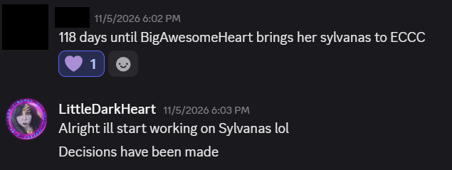
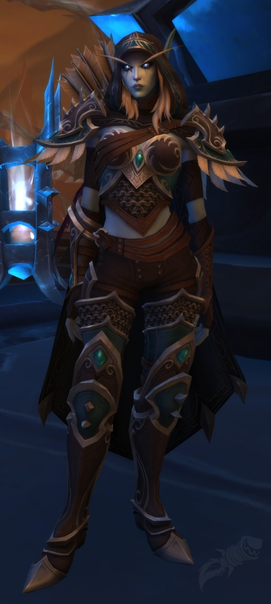
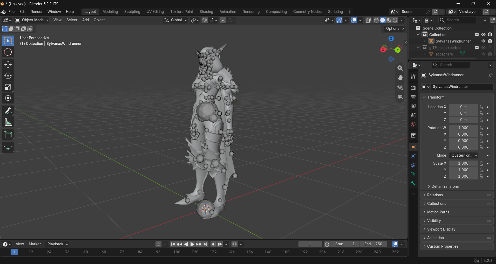
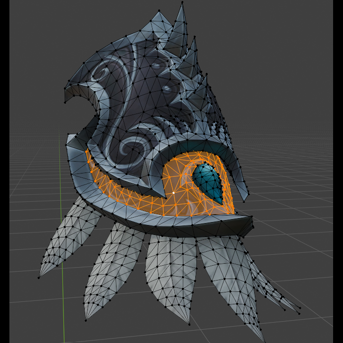
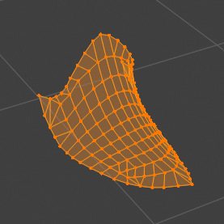
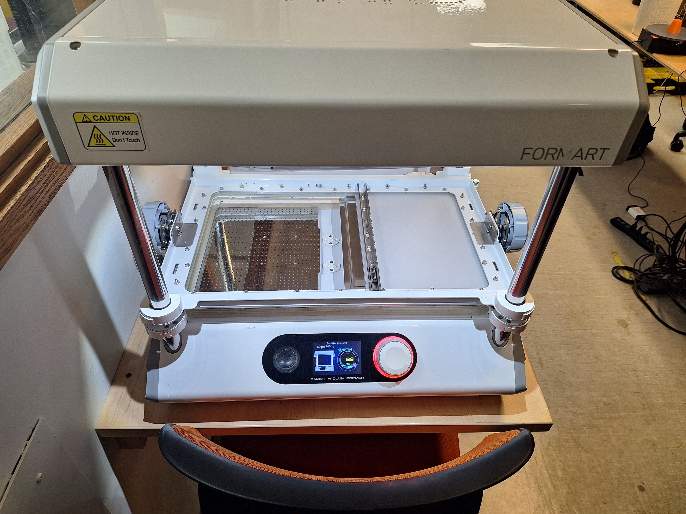
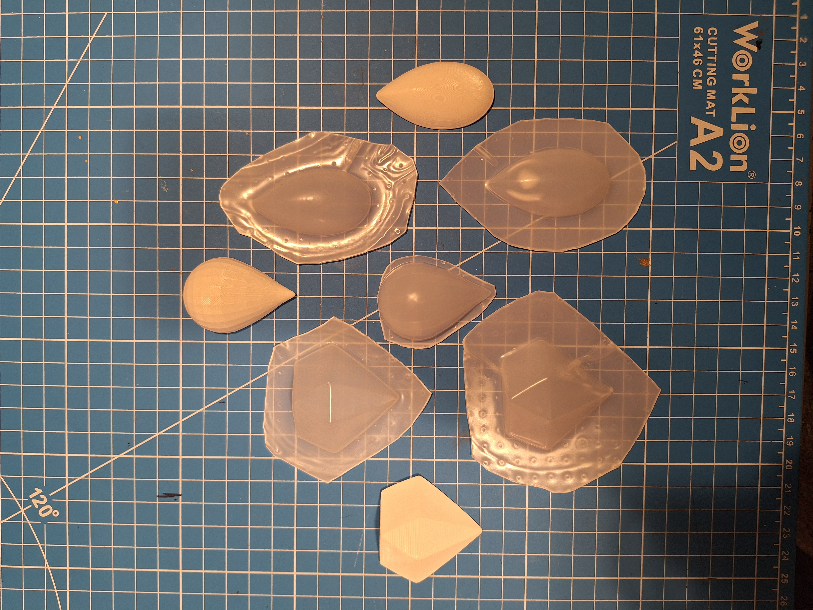

On November 5, a friend informed me that there were 118 days until I brought Sylvanas to Emerald City Comic Con.

Apparently, the decision had been made.

I'd been going back and forth between making Sylvanas Windrunner from *World of Warcraft* and Shion from *Overwatch*. I wanted to make both, and for a while I even considered working on them at the same time. But with ECCC only a few months away, I realized I needed to focus on one if I actually wanted to finish anything.

My friend and I met through the BlizzCon Discord, although we never managed to meet in person at the convention. We're both planning to attend ECCC and New York Comic Con next year, and he suggested splitting the projects between the two events. Sylvanas for ECCC, Shion for NYCC.

He also likes keeping countdowns to conventions.

"Alright I'll start working on Sylvanas lol. Decisions have been made."

And just like that, I had a deadline.

<figure>
    
    <figcaption>Apparently, I have 118 days to make Sylvanas.</figcaption>
</figure>

## Getting back into making things

After BlizzCon, I wasn't particularly motivated to work on costumes. Xal'atath still needs repairs, especially the pauldrons and orbs, and I haven't really wanted to touch them.

I'm stuck on how to fix some of those problems, and right now I don't feel like going through another round of trial and error on things I've already spent months working on. I'd like to have a successful outcome for a change.

But it's not like I've been doing nothing.

I've been catching up on *World of Warcraft* and *Minecraft*, working on my Free Tech Events website, and helping develop the jewelry department at my makerspace. I've also been trying to get my apartment back to normal after months of cosplay construction.

That last one took longer than it probably should have.

For weeks, my workspace was still covered in supplies, fabric hadn't been put away, and everything was generally a mess. Somehow, cleaning it all up felt like a project of its own.

I even went out and bought more organizing bins and shelving. Maybe that was my attempt to convince myself to finally deal with it.

In the meantime, I'd been thinking about what I wanted to make next. I just hadn't felt much urgency to actually start.

Now that I've committed to Sylvanas, I'm finally getting excited about building something again.

## Why Sylvanas?

I didn't start playing *World of Warcraft* until *The War Within*, so I wasn't especially familiar with Sylvanas when I first encountered her in-game.

She was wearing her Shadowlands outfit, which happens to be my favorite of her designs.

I really like the gray color scheme and the overall look of the armor. Her other Shadowlands armor feels a little too bulky for my taste, while some of her older outfits are more revealing than I'd be comfortable wearing. The gray armor has the look I prefer, and it's something I would enjoy wearing.

But seeing her wearing it in-game matters, too. I don't think I would have automatically chosen another version just because that's the one I happened to encounter. It was the combination of liking the design and seeing the character wearing it that made me want to recreate it.

Personality-wise, she's quite different from the characters I usually cosplay. Xal'atath was an easy fit. Sylvanas, especially her post-Shadowlands characterization, seems more reserved, thoughtful, and mature. I'm still learning about her, and I'm curious to see how I'll approach portraying someone whose personality is so different from my own.

And then there's the other reason I'm making Sylvanas.

People keep calling me Sylvanas anyway.

It's happened while I was dressed as Xal'atath, and even while I was cosplaying Ashe from *League of Legends*. I've started joking about how long it'll take before someone calls me Sylvanas whenever I'm in costume.

Apparently, this has happened before.

Back in 2007, for the premiere of *Pirates of the Caribbean: At World's End* when I was still a teenager, I made Giselle's dress from the first Pirates movie. I used a sewing pattern, stayed up until after midnight finishing it, and got maybe three hours of sleep. Some of the floral lace was "dyed" using a brown Crayola marker.

People kept thinking I was Elizabeth Swann.

So, naturally, I eventually made Elizabeth's yellow dress, too. I even made a hoop skirt and a pink corset, although I never wore the finished outfit in public.

Nearly twenty years later, I'm apparently repeating the same pattern.

<figure>
    
    <figcaption>Sylvanas in the armor I'll be recreating, as seen in-game.</figcaption>
</figure>

## Trying something different this time

One of my goals for Sylvanas is to learn how to turn 3D game models into patterns.

For previous costumes, I've relied heavily on premade patterns. I've been sewing since I was a teenager, and modifying commercial patterns to match a character design is something I'm comfortable doing. But I'd like to become less dependent on them, particularly for complicated armor pieces.

Pattern development is also something cosplay competition judges value, so it's a skill I want to improve.

This time, I haven't even looked for Sylvanas patterns.

I was considering buying Armorsmith, but before spending money on software, I wanted to see how far I could get using free tools.

With help from ChatGPT, I used `wow.export` to extract Sylvanas's model from the game, then imported it into Blender.

That part was fairly straightforward.

Actually using Blender was another story.

I'd never used it for this kind of work before, and opening it was a little overwhelming. There are so many settings, and the keyboard shortcuts aren't what I'm used to from other software.

Fortunately, it was easy enough to see how the model was organized into different pieces. The frustrating part was selecting and isolating the exact components I wanted to work with.

I started separating the costume into its major sections: hood, cape, bodice, pauldrons, bracers, belt, quiver, and leg armor.

I'm not trying to become a Blender expert. At least not yet. I just need to learn enough to get useful shapes out of the model.

<figure>
    
    <figcaption>Sylvanas's model imported into Blender. Now to figure out what to do with it.</figcaption>
</figure>

The model isn't something I can simply print out and use as a pattern, but I don't necessarily need it to be.

I've spent years buying commercial sewing patterns and modifying them to match character designs. This feels like a similar process, except I'm starting with a 3D model instead of a sewing pattern.

I can look at the pieces and think several steps ahead about how I'd construct them, what needs to change, and what could be simplified.

If I didn't already have that experience, I think I'd have a much harder time figuring out what to do with the model. But as a starting point, it's useful enough that I can work with it.

## Starting with the pauldrons

Normally, I start a cosplay with the weapon or cape.

This time, I haven't even found Sylvanas's bow model yet. For some reason, she isn't holding it in the model I extracted.

I did take a look at her cape, but it turns out the hood and cape are connected, and the whole thing is more complicated than I originally expected.

So why am I starting with the pauldrons?

Because ChatGPT suggested it. lol

They actually turned out to be a useful place to start.

The pauldrons consist of quite a few individual components, including decorative borders, layered armor pieces, spikes, feathers, and gemstones. I was able to isolate the different parts in Blender and start figuring out how to recreate them.

Some of the geometry is more complicated than it needs to be for physical construction. For example, several layers make up a decorative border, but I can probably use the base shape and build the raised details separately instead of trying to reproduce every layer.

<figure>
  

    
    
  

  <figcaption>
    The assembled pauldron on the left, and one of its isolated components on the right.
  </figcaption>
</figure>

My current plan is to use 5 mm EVA foam for the main shape, 10 mm foam for the raised borders, and foam clay for the smaller details.

I'll start by printing a screenshot of the isolated pauldron and using it to make a paper pattern. Of course, a flat pattern doesn't automatically recreate a three-dimensional shape, so I'll need to experiment with the curves and construction until I get something that works.

I'd also like to make the feathers as individual flexible foam pieces rather than one rigid structure.

And the gemstones are where things got interesting.

## Trying vacuum forming

One of the things I wanted to experiment with was making the gemstones for Sylvanas's pauldrons. I wanted something translucent, sturdy, and potentially suitable for lighting with LEDs.

My makerspace has a Myyard Formart vacuum-forming machine, and I'd never used one before. I asked another volunteer to help me get it down from a shelf, and we ended up figuring it out together.

I brought some 3D-printed gemstones to use as molds and experimented with white 1.0 mm polypropylene sheets. It took a few attempts and some adjustments, but I came away with a handful of usable test pieces.

<figure>
    
    <figcaption>The Myyard Formart vacuum former at my makerspace.</figcaption>
</figure>

<figure>
    
    <figcaption>My first batch of vacuum-formed gemstones, alongside the 3D-printed molds. Not perfect, but a good start!</figcaption>
</figure>

They're not perfect, but they're surprisingly sturdy, and the frosted plastic might work well for diffusing light. I still need to test them with colored LEDs, but I'm excited about the possibilities.

I also discovered a problem when I cut out one of the gems and tried fitting it into EVA foam. The gemstone wasn't tall enough to account for the foam's thickness, so I'll need to adjust the mold before making the final versions.

I could have resin cast the gems or 3D printed them, but I wanted to learn something new. Now vacuum forming is another technique I can add to my toolbox.

I'll be writing a separate post about the process, including what worked, what didn't, and what I learned using the machine for the first time.

## Making something that actually stays on

Of course, after my experience with Xal'atath's pauldrons, there's one part of this project I'm particularly concerned about.

Attaching them.

I spent so much time dealing with Xal'atath's shoulder armor sliding, sagging, and generally refusing to stay where it belonged.

Fortunately, Sylvanas's armor is shaped differently. The pauldrons don't swoop upward the same way, and her cape covers her shoulders.

I think I can attach them directly to the cape using Velcro, similar to what I did with Ashe.

Sometimes the simplest solution is the best one.

I'll still need to make sure the cape supports the armor properly, but at least I have an attachment method in mind before I've finished building everything.

## What's next?

The vacuum-forming experiment was a good first step. I didn't come home with finished gems ready to attach to armor, but I have samples I can work with and a much better understanding of what's possible.

Next, I'll need to see how the gemstones behave with colored LEDs. I also want to start working on the paper pattern for the pauldrons, test the shape in foam, and figure out how to make the feathers flexible.

There are other techniques I'm interested in trying, too. Some parts of Sylvanas's armor have a chainmail-like texture, and I've seen people 3D print flexible sheets of chainmail and scales. I've never worked with TPU before, but it might be a useful material for those details.

And at some point, I should probably find her bow.

For now, though, I'm happy to be working on a new costume. I have a lot to learn, plenty of ideas to test, and an actual deadline to work toward.

It's nice to be excited about building something again.