One of the things I enjoy about cosplay is having an excuse to learn new skills and try equipment I've never used before.

For my Sylvanas Windrunner costume, I needed to figure out how to make the gemstones on her pauldrons and other armor pieces. I wanted something translucent, sturdy, and potentially suitable for lighting with LEDs.

I could have resin cast the gems or 3D printed them, but I'd been curious about vacuum forming. My makerspace happens to have a machine, so why not give it a try?

I'd never used a vacuum former before, and I didn't know much about the machine we had available. Fortunately, another volunteer was willing to help me get it down from its shelf, and we ended up learning how to use it together.

This post documents our first experiments, including the settings we tried, the results, and a few things I learned along the way.

## Preparing the molds

I started by finding some 3D-printable gemstone models online. Rather than designing them from scratch, I resized the existing models to make them approximately the same size and printed them in PLA. I didn't bother editing the models to remove layer lines or faces because I wanted to see just how much I could get away with without being perfectly smooth.

Before using the vacuum former, I wiped down the machine to remove any dust that could potentially burn during heating.

The printed gemstones went directly onto the forming platform. I didn't need to build any special mounts or holders for this first experiment. 

PLA isn't necessarily the ideal material for vacuum-forming molds because it can soften under heat. Mine did warp slightly during the process. The bottoms were no longer perfectly flat afterward, but that wasn't a problem for what I was trying to make.

The smaller details and finer layer lines don't seem like they'll be much of an issue, at least from what I can tell by holding the gemstones up to my phone's flashlight. The blockier model, however, would definitely benefit from some cleanup in Blender.

Next time, I'd spend more time smoothing out the larger imperfections before printing the molds. That's another Blender skill I'll need to learn!

I still need to experiment with painting the gemstones, and it's possible the paint could hide some of those imperfections. But I'd rather start with a smooth surface than rely on paint to cover them up.

<figure>
    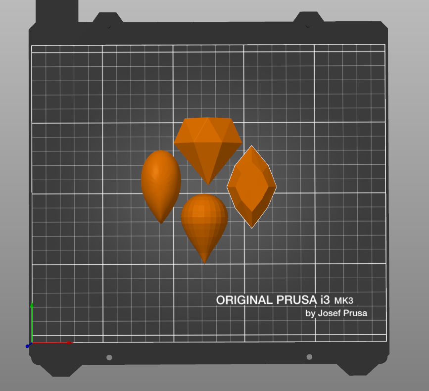
    <figcaption>The gemstone models arranged in the slicer before printing them in PLA.</figcaption>
</figure>

## Getting the Formart running

The machine we used was a Myyard Formart, and it was surprisingly user-friendly. There was a short instructional video online, but I barely watched a minute of it. Turns out I didn't need to. The machine walked us through the process step by step with pictures.

It came with several sheets of plastic, including white 1.0 mm polypropylene (PP) and clear PETG. The sheets had QR codes that the machine could scan to identify the material. I'm not sure whether it requires the manufacturer's material or if you can use something else.

The Formart also accommodates larger sheets by repositioning an adjustable bar in the frame.

<figure>
  

    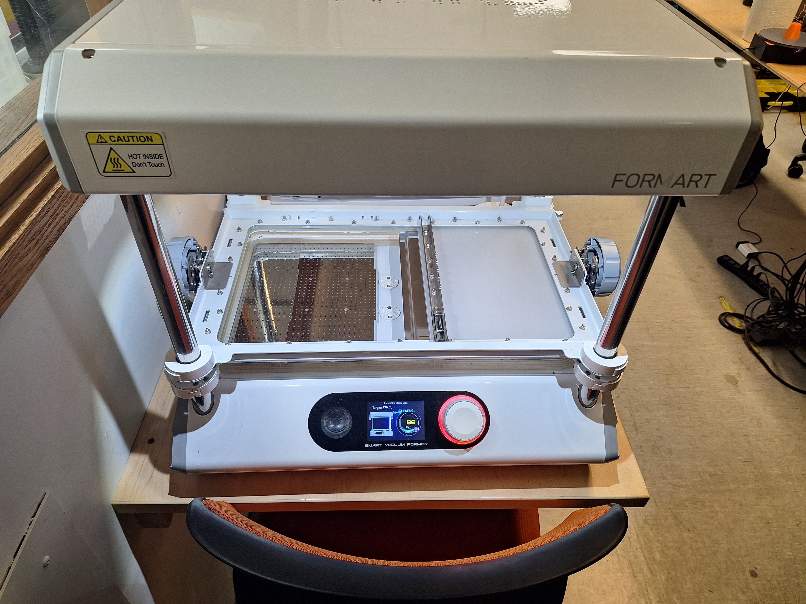
    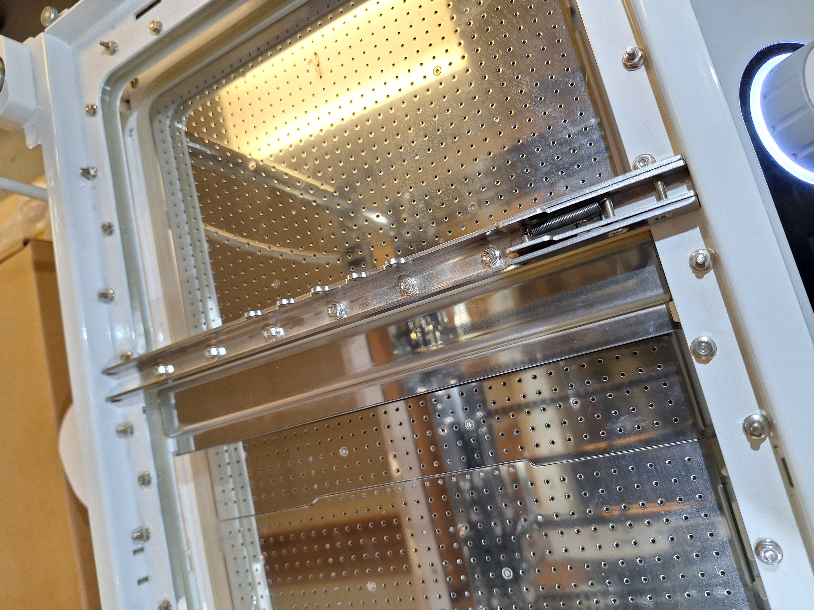
  

  <figcaption>
    The Myyard Formart at my makerspace. The adjustable bar allows the machine to accommodate different sheet sizes.
  </figcaption>
</figure>

We started by letting the machine heat up. The initial preset was 140°C. At this stage, the plastic sheet frame stayed lowered, and we didn't put the gemstone molds onto the platform yet.

Once the machine was ready, we locked the plastic sheet into the frame and raised it to the top, near the heater.

The machine then continued heating toward its second temperature setting. While it was heating, we placed the gemstone molds on the platform.

When the machine notified us that it was ready, the vacuum started running.

Loudly.

We lowered the frame with the heated plastic over the molds, and the vacuum pulled the sheet around their shapes.

<figure>
    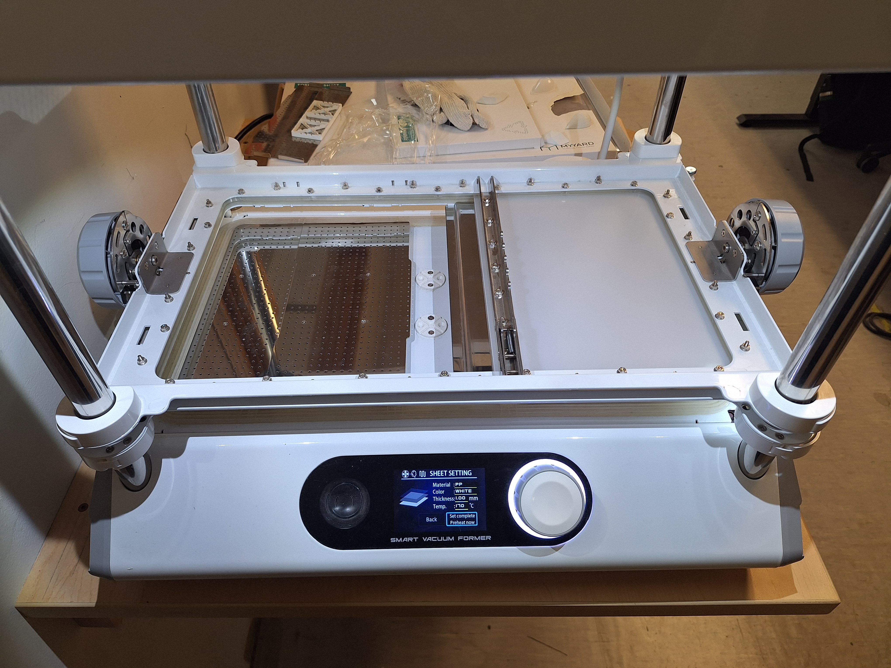
    <figcaption>The plastic sheet secured in the frame before forming.</figcaption>
</figure>

## The first attempt: Too much sagging?

Our first attempt didn't go quite as planned.

The machine was set to 170°C, but it was taking a long time to reach the target temperature. Meanwhile, the plastic sheet was getting softer and sagging farther and farther down.

I knew the plastic was supposed to soften, but I wasn't expecting it to droop quite that much. It looked like it was practically going to fall out of the frame!

Eventually, the plastic looked like it was already starting to cool down, even though the machine hadn't reached its target temperature. We decided to stop rather than lower the sheet over the molds.

I'm still not sure how much sagging is normal or what exactly was happening with the plastic.

<figure>
  

    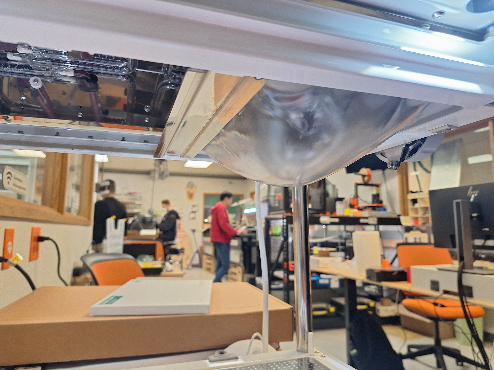
    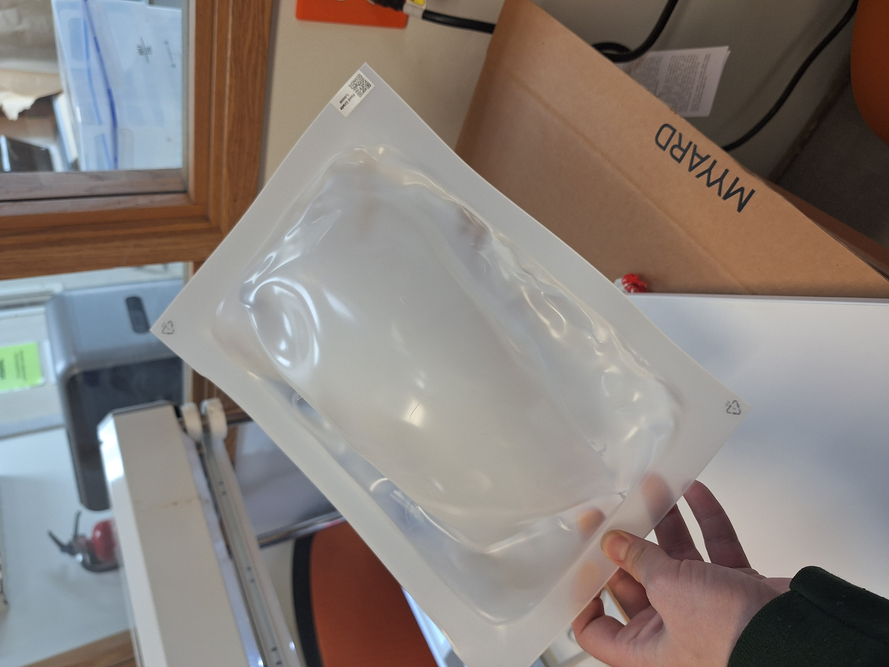
  

  <figcaption>
    Our first attempt at 170°C. The plastic sagged dramatically while the machine was still heating, so we stopped before forming.
  </figcaption>
</figure>

For our next attempt, we lowered the target temperature to 155°C. The machine reached that temperature sooner, and we were able to complete the forming process.

I don't know whether 155°C is the ideal setting for this material, but it worked better for our experiment.

These temperatures are simply the settings we used on this machine with the supplied material, not recommendations for every vacuum former or type of plastic.

## Finally, some gemstones!

Lowering the target temperature to 155°C seemed to do the trick. When the machine notified us that it was ready, the vacuum started running, and we lowered the heated plastic over the 3D-printed gemstones.

The plastic formed around the molds, although we still ended up with some wrinkles. I'm not sure whether I was lowering the frame firmly enough or if something else was causing them.

We tried forming several gemstones at once, but the best result came when the other volunteer tried using just one mold. That sheet came out much smoother.

Fortunately, most of the wrinkles were between the gemstones, in the plastic I was going to cut away anyway. The gems themselves looked fine for what I needed.

The formed plastic also released from the molds without much trouble.

<figure>
    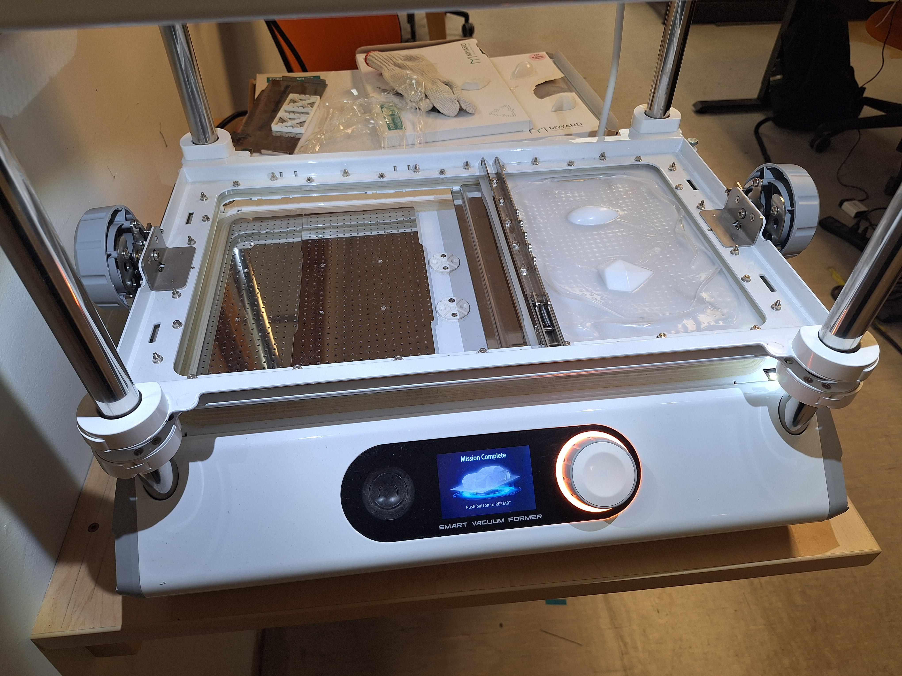
</figure>

<figure>
  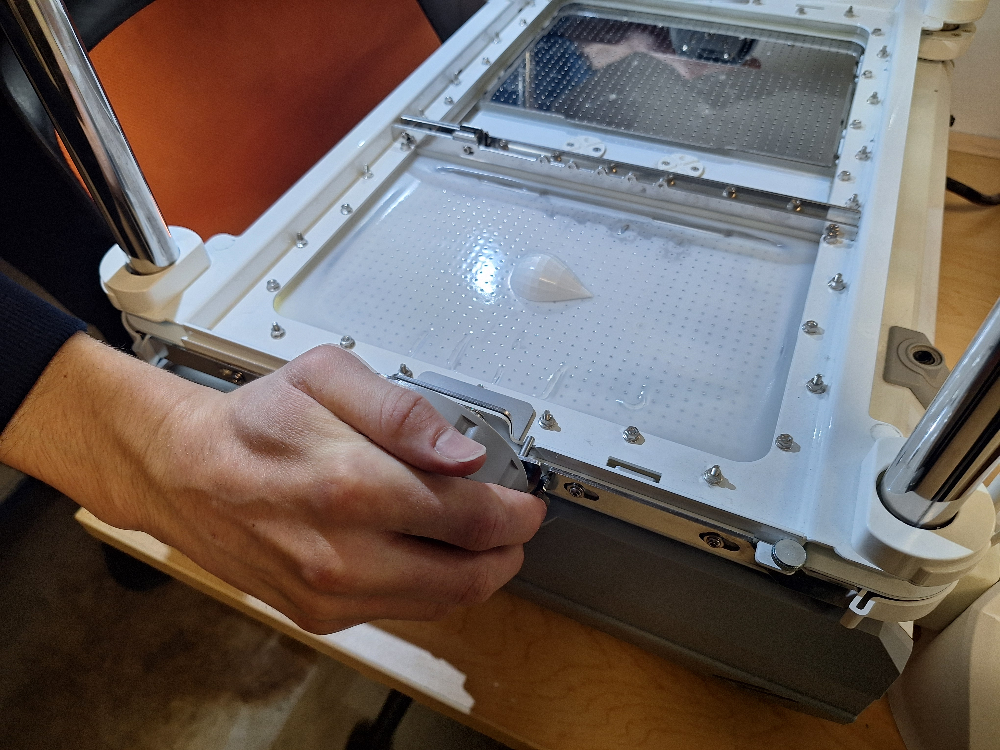
  <figcaption>
    Forming multiple gemstones left wrinkles between the shapes. Using a single mold produced a smoother result.
  </figcaption>
</figure>

We experimented with two different materials. The white polypropylene was frosted and surprisingly rigid, which is promising for my costume. The PETG, on the other hand, was clear and flexible.

And apparently, vacuum-formed PETG gemstones make excellent fidget toys.

I kept popping one inside out and back again. Very satisfying.

<figure>
  

    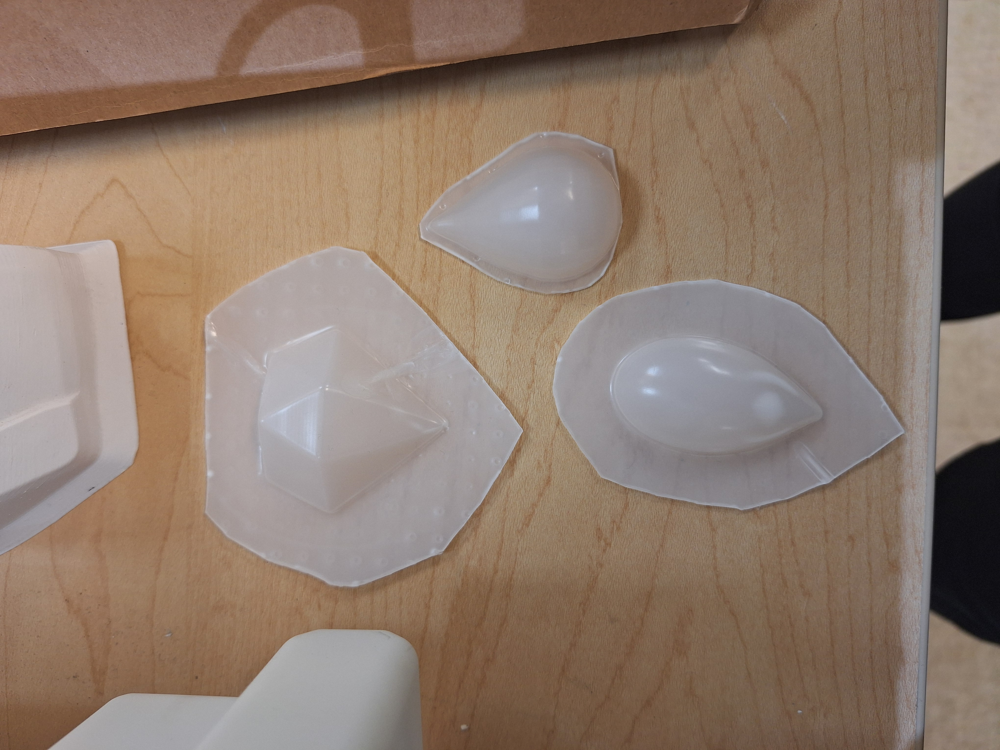
    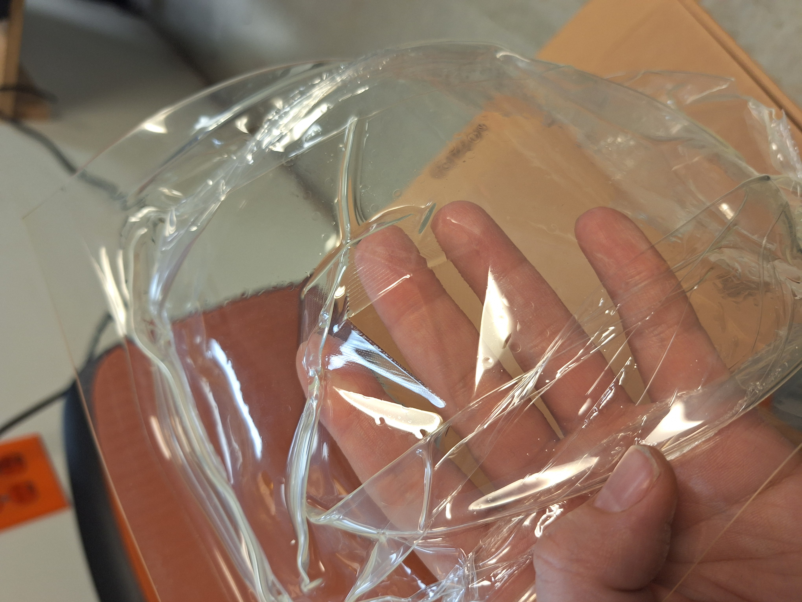
  

  <figcaption>
    White polypropylene versus clear PETG. The polypropylene was much sturdier, while the PETG was flexible enough to pop inside out.
  </figcaption>
</figure>

## Cutting and test fitting

Once I had some usable gemstones, I needed to separate them from the plastic sheets.

The Formart actually came with a pair of scissors, which I used to cut around the gemstones. I'm not sure whether they were specially designed for cutting plastic, but they worked well enough. I left a small edge around each gem rather than trimming right up against the shape.

I then tried fitting one into a piece of EVA foam and discovered something I hadn't accounted for.

The gemstone wasn't tall enough!

Once I recessed it into the foam, the thickness of the material reduced how much of the gemstone protruded above the surface. I'll need to make the 3D-printed molds taller so the final gems have the height I want.

Fortunately, that's something I discovered during testing rather than after finishing the armor.

<figure>
    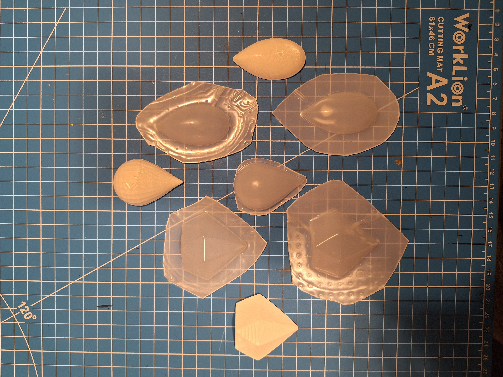
    <figcaption>The finished test pieces, cut from the plastic sheet. The molds will need to be taller to account for the thickness of the EVA foam.</figcaption>
</figure>

## What I'd change next time

Overall, I'm pretty happy with how this experiment turned out. The gemstones weren't perfect, but they were good enough to test, and I learned how to use a new machine.

The biggest surprise was how sturdy the white polypropylene turned out to be. I expected something that would hold its shape, but not something this rigid. I'm confident it'll hold up to the occasional bump at a convention, which is exactly what I need.

For the next batch, I'll make the 3D-printed molds taller to account for the thickness of the EVA foam. I'd also like to experiment with the number and spacing of molds to see whether I can reduce the wrinkles.

The next challenge is figuring out the color and lighting. I haven't tested the gemstones with LEDs yet, and I'll need to find a paint that adheres properly to polypropylene without blocking too much light.

Even if I don't have the exact color I want, I can test the painting process with something else first. I'd rather find out whether it works on a spare gemstone before committing to the final pieces.

I could have resin cast these gemstones or 3D printed them, but I wanted to learn vacuum forming. Now it's another technique I can add to my toolbox.

And I already have a pretty good excuse to use it again.